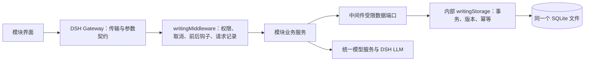

# 工作台请求中间件

维护日期：2026-10-24。`writingMiddleware` 是工作台所有宿主业务请求的统一执行入口。数据库结构仍为 v6，本次没有新增迁移。

## 请求与数据路径



数据库 read/inspect/save、Wiki overview/browse/read、世界观 invoke、质量检测 invoke、模型 read/save、对话 stream 均经过中间件。模型内部 prepare 同样登记为内部请求。各模块保持既有 Remote namespace、参数和返回结构；前端不需要改用通用 SQL 或路由字符串接口。

“所有请求”指本插件的宿主业务接口。DSH 自己的账户、文件下载和其他插件接口不在本插件拦截范围；Gateway 仍先验证传输契约。小说当前只有会话内存和文件导入导出，没有数据库或宿主请求；未来新增持久化必须接入中间件。

## 模块边界

| 模块 | 中间件数据接口 | 写入范围 |
| --- | --- | --- |
| 数据库配置 | `data('database').inspect` | 配置仍由 ConfigEditor 锁内保存；运行时不建库或迁移 |
| Wiki | 状态、实例、项目列表、只读快照 | 没有写端口 |
| 世界观 | 状态、实例、资料库快照及命令 | 仅 `story` owner / `writing-world-library` 项目 |
| 作者人格 | 状态、实例、资料库快照及命令；不暴露 consume | 仅 `story` owner / `writing-author-persona-library` 项目；内部公开服务走 task，远程走 owner request |
| 质量检测 | 状态、实例、项目列表、质量快照及质量命令 | 质量存储契约定义的规则、报告和回执 |
| 模型、对话 | 无数据端口 | 使用宿主模型和配置能力 |

模块只依赖共享端口类型。SQL、连接、结构探测和事务都在 `src/infrastructure/storage`，中间件是生产模块唯一的数据接入方。`/database` 保留兼容导出给基础设施与测试；业务模块不能用它绕过中间件。中间件不是针对同进程恶意插件的沙箱。

## 可插拔请求钩子

宿主扩展声明必需依赖 `writingMiddleware`，注册随其 Fiber 撤销：

```ts
import type { Context } from '@deepseek-ai/cordis'
import type {} from 'dsh-writing-workbench/middleware'

export const inject = ['writingMiddleware']
export function apply(ctx: Context) {
  ctx.effect(() => ctx.writingMiddleware.use({
    id: 'example-policy',
    before(request) {
      // 可按 module、operation、layer 做同步准入检查；抛错会阻止执行。
    },
    after(completion) {
      // 记录耗时和结果；这里不改变业务返回值或发起重复提交。
    },
  }))
}
```

前置钩子按注册顺序执行；后置钩子逆序执行，能观察成功、失败和取消。钩子收到冻结的元信息，不收到正文、完整输入、结果、数据库路径或错误堆栈。后置钩子异常计入 `observerFailures`，继续执行其他观察者，不将已提交业务结果变成失败。钩子只允许同步逻辑；异步前置钩子被拒绝，异步后置钩子的异常被接收并计数，避免悬空拒绝。耗时业务留在模块服务，不能在 SQL 事务中调用模型。

`use` 返回撤销函数；撤销后不再执行该钩子的后续回调。重复 ID 被拒绝。中间件提供 `request`、`stream` 和内部 `task`，通过 AsyncLocalStorage 关联内部数据请求与父请求，避免并发请求串线。`diagnostics()` 仅在宿主提供活动数量、观察者错误数及最近 200 条元信息，不新增远程诊断接口。`succeeded` 表示调用正常返回，模块返回的结构化业务拒绝仍由其业务合同解释。

## 取消、提交与生命周期

- 所有请求先验证宿主 owner 和取消状态，再执行扩展及模块逻辑。未授权请求不会执行业务或前置钩子；保留各模块既有 owner 错误码。
- 调用方取消与中间件卸载信号传入业务服务；流提前关闭会取消生产者并关闭迭代器。取消是协作式的，不代表已提交写入撤销或远端模型停止计费，不进行隐式重试。
- 每次数据操作重新检查生命周期与库状态；数据端口不暴露数据库连接。原有同步快照、事务回滚、CAS、幂等回执与跨库校验继续生效。质量检测取消后的结果核对仍由质量服务负责。
- 配置保存可能触发整棵组合插件重载；不能仅因旧中间件被卸载就把已提交配置报告为失败。数据库配置继续回读确认，模型保存返回已提交的选择。
- `writingStorage` 是中间件的必需依赖，业务宿主模块依赖中间件；存储或根插件移除会撤销消费者，恢复后创建新中间件实例。模块卸载不关闭其他消费者的共享库，不删除数据。

## 新模块接入与验证

1. 新增模块自己的请求/结果与业务校验，Remote 入口调用 `writingMiddleware.request` 或 `stream`。
2. 在共享合同定义最小数据端口，在中间件提供实现；SQL 放入存储基础设施。不要将 `writingStorage` 或任意 SQL 传给业务模块。
3. 声明 `writingMiddleware` 依赖，注册钩子时绑定 Fiber 生命周期。
4. 在具备本地 `tests/` 的环境运行 `npm run test:local`；根目录测试不随 Git 分发，缺少时需单独记录未验证。`tests/middleware.test.mjs` 检查全部 Remote 入口及模块存储边界，并覆盖权限、钩子、隔离、回滚、CAS、幂等、并发、取消和卸载。


知识核心管理请求使用 `knowledge` 模块与受限 `KnowledgeDataPort`，对外查询使用 `knowledge-query` 请求身份且不授予数据库端口。两者都通过 owner 检查；组合根只向查询适配层提供 policy/search/answer 三项能力。详细职责见[知识核心](../modules/knowledge-core/README.md)和[查询合同](../modules/knowledge-query/README.md)。


功能测试集导出模块没有 Remote、数据端口或模型端口；独立 `backtesting/` 只处理文件快照与纯函数，不通过持久化业务入口执行回测，不接入数据库。报告只存于 Git 忽略的 `backtest-reports/`。
